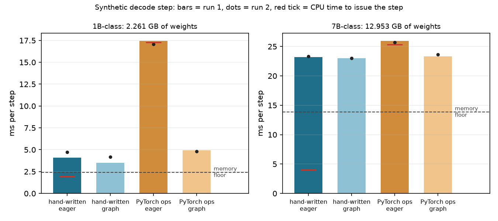
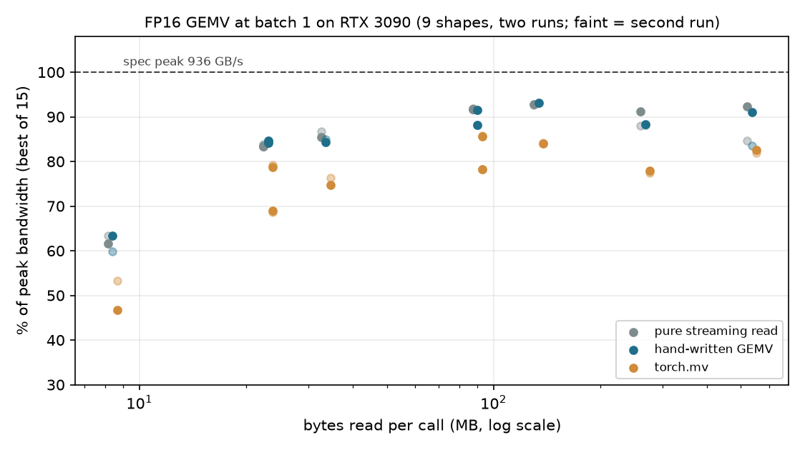

# Launch overhead lab: when does eager mode cost you?

A decode step at batch 1 is a few hundred small kernels. In eager mode each one is launched
from Python; with CUDA graphs the whole step is recorded once and replayed with one call.
This lab measures, on one RTX 3090, what a launch costs, how close a hand-written GEMV gets
to the memory-bandwidth floor, and when launch cost actually shows up in step time.

Everything is hand-written CUDA C compiled at run time with NVRTC and launched through the
CUDA driver API. PyTorch is used for memory, reference results and graph capture.

## Findings

**1. A launch costs 7 µs from Python, 15 µs as a PyTorch op, and under 1 µs inside a CUDA graph.**
Measured with empty kernels (15 trials of 20,000 launches; two runs agree within 2%):

| how the kernel is launched | per launch |
|---|---:|
| PyTorch op (`t.add_(1)`), eager | 15.3 µs |
| `cuLaunchKernel` from Python, arguments packed once | 7.2 µs |
| same PyTorch op, replayed from a CUDA graph | 1.1 µs |
| same empty kernel, replayed from a CUDA graph | 0.9 µs |

**2. Launch cost only shows up when the CPU cannot stay ahead of the GPU.**
A synthetic decode step (7 GEMVs and 5 small kernels per layer, no attention) was built at two
sizes: hidden 2048 / intermediate 5632 / 22 layers (TinyLlama-1.1B's sizes, but with full-width
k and v projections) and hidden 4096 / intermediate 11008 / 32 layers (Llama-2-7B's sizes).
It was issued two ways: as hand-written kernels with pre-packed arguments,
and as ordinary PyTorch ops, the way eager-mode model code is written. "Issue" is the host
time to enqueue one step; eager and graph were measured interleaved, A-B-B-A.



| step | kernels | CPU issue | eager | graph | eager / graph |
|---|---:|---:|---:|---:|---:|
| 1B-class, hand-written | 264 | 1.9–2.0 ms | 4.1–4.7 ms | 3.5–4.2 ms | 1.13–1.17 |
| 1B-class, PyTorch ops | 616 | 16.8–17.3 ms | 17.1–17.4 ms | 4.8–4.9 ms | **3.53–3.55** |
| 7B-class, hand-written | 384 | 3.8–4.0 ms | 23.2–23.3 ms | 23.0 ms | 1.01 |
| 7B-class, PyTorch ops | 928 | 25.3–25.4 ms | 25.7–25.9 ms | 23.4–23.6 ms | 1.09–1.11 |

(ranges are the medians of two runs.)

The PyTorch-op step spends 27–28 µs of CPU per kernel. For the 1B-class step that is
17 ms of CPU for under 5 ms of GPU work, so the GPU waits and eager is 3.5× slower than the
graph. For the 7B-class step the GEMVs are long enough that the GPU is busy for most of the
time the CPU spends issuing, and the gap is about 10%. The hand-written step issues in 2–4 ms,
well under its GPU time, so a graph barely helps.

A simple model predicts the eager numbers: **eager step ≈ max(CPU issue time, GPU time)**.
It is within 3% for three of the four rows. The exception is the 1B-class hand-written step,
where eager is 0.6 ms (about 2 µs per kernel) slower than the model: the GPU is never starved,
but stream-ordered launches still leave short gaps between kernels that a graph removes.

The practical check that follows: time how long the CPU takes to issue one step, and compare
it with the step time under a CUDA graph. If issue time is close to or above the graph time,
the step is launch-bound, and graphs or fewer, fused kernels will help. If it is far below,
they will not.

**3. The hand-written GEMV reaches the card's practical streaming bandwidth.**
For matrices of 23 MB and more it reaches 83–93% of the 936 GB/s spec in its best trial,
within 4 points of a kernel that only streams the same bytes (and sometimes above it). On the
same shapes at batch 1 its best trial is 2–23% faster than `torch.mv`'s. At 8 MB no kernel gets
past 64%: the call is too short to reach full bandwidth.



## Method

- **Kernels** (`lab/kernels.cu`): GEMV with one warp per output row and 16-byte loads (fully
  coalesced, FP32 accumulation), a block-wide RMSNorm, SiLU·mul, residual add, an empty
  kernel, and a streaming-read kernel used as a bandwidth ceiling.
- **Correctness** (`tests/`): every kernel is checked against an FP32 PyTorch reference,
  including shapes that do not fill a block, and one test corrupts a weight row to make sure
  the comparison can fail. Another test checks that driver-API launches on PyTorch's capture
  stream are recorded into the graph.
- **Do the tests catch bugs?** `tests/check_tests_can_fail.py` breaks the code in 11 ways,
  one at a time (for example dropping the last 16-byte chunk of each GEMV row, keeping only
  the first warp in a block reduction, or launching outside the capture stream), and checks
  that the tests fail. All 11 are caught. The first run caught 10: RMSNorm dividing by n - 1
  slipped through a 1% tolerance, which was then tightened to 0.2%. For vectors of a few
  thousand elements that particular mistake is smaller than FP16 rounding, so only the small
  test sizes can see it.
- **Timing**: host wall clock with a synchronize for anything that includes CPU work, CUDA
  events for GPU-only work. Variants are interleaved A-B-B-A (or A-B-C-C-B-A) so slow drift
  and interference hit all of them. 15 trials per point; reports give the median and the
  range, and the GEMV chart uses the best trial, since interference only ever adds time.
- **L2**: the RTX 3090 has 6 MB of L2, so each GEMV measurement rotates through enough copies
  of the matrix that the working set is at least 256 MB and every call reads from DRAM.
- **GPU state**: SM and memory clocks, temperature and power are recorded with every
  measurement (`results/*.json`).

## Limitations

- **Shared desktop GPU under WSL2.** This card also drives a Windows desktop, and other
  processes (browser, launchers, overlays) hold GPU contexts. With clocks steady at
  2010–2025 MHz SM and 9501 MHz memory, the same 7B-class graph replay took anywhere from
  16.5 to 24.7 ms across rounds, while a single 90 MB GEMV stayed at 821–856 GB/s
  (`bench/diagnose_variance.py`). Ratios measured interleaved repeat across runs; absolute
  step times should be read as ±20%. When the GPU is busier, the GPU time grows and the
  eager/graph gap for the 7B-class PyTorch step shrinks.
- **WSL2 launch path.** Launch latency under WSL2 can differ from native Linux; the per-launch
  numbers are for this setup.
- **One CPU.** Issue costs scale with single-thread CPU speed (here an i7-10700F). A slower
  server CPU moves more steps into the launch-bound regime.
- **The step is synthetic.** No attention, no KV cache, no sampling, random weights, FP16
  only (no quantized kernels), one GPU (no tensor-parallel all-reduce). It isolates weight
  bytes and kernel count; a real model has more kernels per layer.
- **GeForce clocks cannot be locked**, which adds run-to-run noise to everything above.
- **One machine.** Everything was measured on one RTX 3090 under WSL2; nothing has been
  repeated on native Linux or another GPU. The max(CPU, GPU) model is checked on four step
  configurations only. The correctness tests need a GPU, so they run locally, not in CI.

## Run it

Needs an NVIDIA GPU, Python 3.10+, and the packages in `requirements.txt` (no nvcc).

```bash
pip install -r requirements.txt
python -m pytest                                   # correctness
python tests/check_tests_can_fail.py               # the tests catch 11 deliberate bugs
python bench/launch_overhead.py results/launch_overhead.json
python bench/gemv_roofline.py results/gemv_roofline_run1.json
python bench/decode_step.py results/decode_step_run1.json
python bench/make_charts.py
```

## Files

```
lab/kernels.cu            the CUDA kernels
lab/cuda_util.py          NVRTC compile + driver-API launches on PyTorch's stream
lab/timing.py             interleaved timing, GPU state
bench/launch_overhead.py  cost of one launch, eager vs graph
bench/gemv_roofline.py    GEMV vs the bandwidth ceiling
bench/decode_step.py      synthetic decode step, eager vs graph
bench/make_charts.py      the two charts
bench/diagnose_variance.py  why absolute step times move between runs
tests/test_kernels.py     correctness against PyTorch
tests/check_tests_can_fail.py  breaks the code on purpose and checks the tests notice
results/                  raw JSON for every number above
```

Environment of the published numbers: RTX 3090 (driver 610.88), i7-10700F, WSL2, Python 3.12,
PyTorch 2.13 (CUDA 13.0), cuda-python 13.3.
